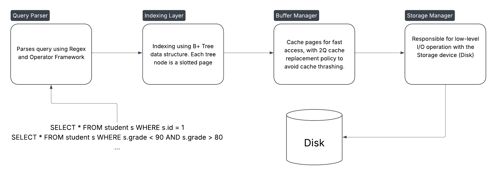

# TomDB

TomDB is NoSQL Database designed for performance and flexibility at scale.

## Documentation

- [Design overview and reading guide](docs/design/README.md): component relationships and a walkthrough of the storage engine.
- [Development setup](docs/development.md): Docker, CLion, and debugging setup.

The design docs are grouped by [records](docs/design/records/fields-and-tuples.md), [storage](docs/design/storage/storage-manager.md), and [buffer management](docs/design/buffer/buffer-manager.md). They describe current behavior, ownership, tradeoffs, and implementation limits.

## High-Level Architecture

The diagram shows the broader architecture direction; the roadmap below distinguishes implemented components from planned work.

## Project Roadmap
### Storage engine
✅ Page, tuple, field \
✅ File manager \
✅ Storage manager \
✅ Buffer manager \
✅ B-tree indexing

### Query layer
🚧 Query parser \
⏳ Query planner and execution engine

### Reliability
⏳ Transactions and concurrency control \
⏳ Write-ahead logging and crash recovery

### Serving
⏳ Database server and client protocol

### Distributed architecture
⏳ Partitioning and data placement \
⏳ Replication and consensus \
⏳ Distributed transactions / consistency model \
⏳ Distributed query execution \
⏳ Membership, failure detection, and rebalancing

## Technical Debt

### High priority

1. **Find a page with space for a tuple.** Add a mechanism to the [file manager](docs/design/storage/file-manager.md) to locate an existing page where a tuple will fit, rather than always allocating a new page.
2. **Bypass the kernel's page cache.** Investigate direct I/O for the [buffer manager](docs/design/buffer/buffer-manager.md) to avoid caching pages in both the buffer pool and the kernel's page cache. Measure the performance impact and account for platform support and I/O alignment requirements.
3. **Revisit the page pinning logic in [b_tree.tpp](include/index/b_tree.tpp) so exclusive access is honored**
4. **Add deletion logic in [b_tree.tpp](include/index/b_tree.tpp)**
5. **Add range query logic [b_tree.tpp](include/index/b_tree.tpp)**
6. **Add update query logic [b_tree.tpp](include/index/b_tree.tpp)**
