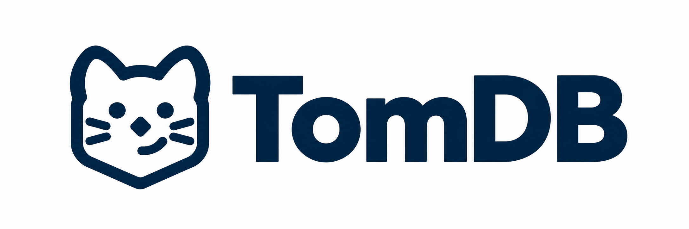

[](https://sonarcloud.io/component_measures?id=hpham12_TomDB&metric=coverage)
[](https://sonarcloud.io/component_measures?id=hpham12_TomDB&metric=reliability_rating)

# 

TomDB is a document database designed for performance and flexibility.

The current CLI creates and removes documents, inserts flat JSON records, and looks up records by `id` using a disk-backed B-tree. In TomDB, a *document* is a named collection of records.

## Quickstart

Build TomDB from the repository root with Docker Compose.

```sh
docker compose up -d
docker compose exec tomdb cmake -S . -B /tmp/tomdb-build
docker compose exec tomdb cmake --build /tmp/tomdb-build --parallel
```

Try the CLI with a fresh database.

```sh
docker compose exec -T tomdb /tmp/tomdb-build/tomdb <<'EOF'
CREATE DOCUMENT demo_users
INSERT INTO demo_users VALUE {"id": 1, "name": "Tom", "age": 30}
SELECT name, age FROM demo_users WHERE id = 1
EOF
```

Expected output is `{name: "Tom", age: 30}`. Replace `name, age` with `*` to return every field. `REMOVE DOCUMENT demo_users` deletes the document and all its records.

## Query and storage limits

- The CLI reads one statement per line until EOF. Keywords are case-insensitive and a trailing semicolon is optional. Document names and named projections are case-sensitive and match `[A-Za-z_][A-Za-z0-9_]*`. Document names have a 50-character limit.
- `INSERT` accepts one flat JSON object with unique field names and string, signed 32-bit integer, or single-precision floating-point values. The lowercase `id` field must be an integer from `0` to `2147483647`. The serialized record must fit on one data page.
- `SELECT` supports equality on `id` and returns at most one record. A lookup for an absent ID in an existing document produces no output. With duplicate IDs, the choice of matching record is unspecified.
- The CLI stores its catalog, index files, and data files under `/.tomdb/`. With the supplied Compose configuration, the files survive CLI restarts and are lost when the container is removed.

## Documentation

- Build, test, and configure CLion with the [development guide](docs/development.md).
- Follow a query from the CLI to disk in the [design guide](docs/design/README.md).

## Technical debt

See the full backlog and priorities in [tech-debts.md](docs/tech-debts.md).

## Roadmap

- Queries and indexes — record deletion, updates, and range scans.
- Reliability — transactions, concurrency control, write-ahead logging, and crash recovery.
- Serving — a database server and client protocol.
- Distribution — partitioning, replication, consensus, distributed queries and transactions, consistency, membership, failure detection, and rebalancing.
