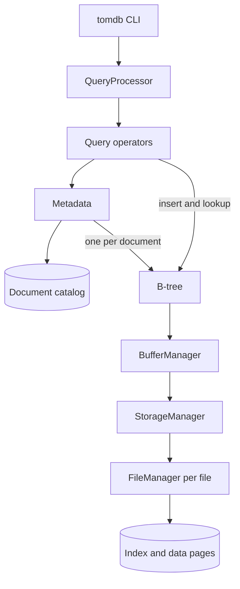

# TomDB design documents

TomDB runs as a single process. The CLI reads one statement per line, and `QueryProcessor` parses and executes it through an operator. A print operator displays matching `SELECT` results. [CLI](../../src/main.cpp) · [Query processor](../../src/query/query_processor.cpp) · [Operators](../../src/query/operators.cpp)

## Query path

`Metadata` loads the document catalog at startup and opens one B-tree per document. `CREATE DOCUMENT` and `REMOVE DOCUMENT` update the catalog and create or remove both files for the document. [Metadata implementation](../../src/metadata.cpp)

`INSERT` converts a flat JSON object to a tuple, stores it on a data page, and indexes its `id`. B-tree leaves map keys to data page IDs and slot numbers. `SELECT` uses that mapping to retrieve one tuple and project the requested fields. [JSON parser](../../src/query/insert_json.cpp) · [B-tree implementation](../../include/index/b_tree.tpp)

## Component reference

- Shared sizes, identifiers, and file paths. [Configuration](configuration.md)
- How values become bytes on disk. [Fields and tuples](records/fields-and-tuples.md) · [Slotted pages](records/pages.md) · [Index nodes](index/node-serialization.md)
- How page I/O is allocated and routed. [File manager](storage/file-manager.md) · [Storage manager](storage/storage-manager.md)
- How pages are pinned, cached, and evicted. [Buffer manager](buffer/buffer-manager.md) · [Frames and guards](buffer/frames-and-guards.md) · [Frame locks](buffer/frame-lock-table.md) · [Replacement policy](buffer/replacement-policy.md)
